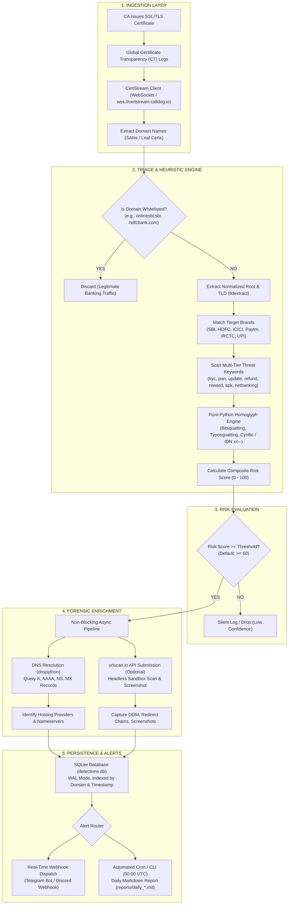

# 🛡️ Indian Bank Phishing Domain Monitor

[](https://www.python.org/)
[](tests/)
[](https://github.com/astral-sh/ruff)
[](src/storage/)
[](src/ingestion/)
[](LICENSE)

An enterprise-grade, real-time **Certificate Transparency (CT) phishing detection and forensic analysis engine** engineered specifically for Indian banking institutions, fintech platforms, and Unified Payments Interface (UPI) payment gateways.

The engine continuously intercepts global SSL/TLS certificate issuance, scores newly registered domains using multi-tiered heuristic rules and homoglyph analysis, enriches active threats with asynchronous DNS and sandbox intelligence, stores forensic records in a high-concurrency SQLite store, and delivers real-time notifications to security operations teams via Telegram, Discord, and automated daily audit reports.

---

## 📌 Threat Context & Motivation

Phishing campaigns targeting the Indian financial sector typically exploit short-lived domain registrations and rapid SSL/TLS provisioning. Fraudsters routinely stand up credential-harvesting pages and APK download portals imitating prominent public and private sector banks, UPI service providers, and tax portals:

* **Urgent KYC / PAN Suspension Panics** (`sbi-kyc-verification-update.com`)
* **Fake UPI / Cashback Refunds** (`phonepe-reward-refund-claim.in`)
* **Malicious Netbanking APK Droppers** (`hdfc-netbanking-app.apk.download`)
* **Homoglyph & Punycode Deceptions** (`раytm.com` with Cyrillic `а`, `1cici-bank.com` via leetspeak)

By actively ingesting the global **Certificate Transparency (CT)** log stream, this platform detects fraudulent domains the moment a certificate authority issues an SSL/TLS certificate—**hours or days before malicious sites can be actively weaponized against citizens and organizations**.

---

## 🏛️ System Architecture



---

## ✨ Key Features

* **Real-Time CT Stream Ingestion**: Connects to a CertStream-compatible WebSocket feed (default `wss://certstream.calidog.io`) with exponential backoff reconnection, an idle watchdog that abandons a feed after 60 s without certificates (heartbeats don't count), and automatic rotation through fallback feeds such as a self-hosted `certstream-server-go`.
* **Strict Whitelist Engine**: Eliminates false positives by filtering official banking portals, corporate infrastructure, and Indian government financial hubs (`onlinesbi.sbi`, `hdfcbank.com`, `incometax.gov.in`, `rbi.org.in`, etc.).
* **Brand Catalog** (`TARGET_BRANDS` in `src/config.py`):
  * **Banks**: State Bank of India (SBI, YONO), HDFC Bank, ICICI Bank, Axis Bank, Punjab National Bank (PNB), Bank of Baroda (BOB), Canara Bank, Kotak Mahindra Bank.
  * **Fintech & UPI**: Paytm, PhonePe, BHIM, NPCI, UPI.
  * **Government Portals**: IRCTC, Income Tax Department, EPFO, UIDAI (Aadhaar).
  * The whitelist also covers official domains of other banks (Union Bank, IndusInd, Yes Bank, IDBI, and more) so they are never flagged.
* **Ambiguous-Alias Handling**: Aliases that are also ordinary words (`axis`, `upi`, `bhim`, `mycards`, `imobile`) only count inside a longer word when the domain also carries banking context, so `praxis-login.com` and `login.upicorn.io` are not flagged while `axis-kyc-update.top` and `axiscard-kyc.top` are.
* **Homoglyph & Punycode Defense**: Pure-Python lookup tables detecting Cyrillic and Greek substitutions (`а`, `о`, `е`, `р`, `с`), IDN Punycode (`xn--`), bitsquatting, leetspeak (`p4ytm`, `1cici`), and typosquatting permutations without requiring native C compilers on Windows or Linux.
* **Multi-Tiered Keyword Scoring**:
  * **Tier 1 (+18, urgent lures)**: `kyc`, `pan`, `pancard`, `apk`, `refund`, `reward`, `cashback`, `claim`, `otp`, `customercare`, `helpline`, `tollfree`.
  * **Tier 2 (+12, banking & security actions)**: `netbanking`, `banking`, `login`, `signin`, `auth`, `update`, `verify`, `verification`, `secure`, `security`, `portal`, `online`, `support`, `service`, `block`, `activate`, and similar.
  * **Tier 3 (+6, account terms)**: `account`, `credit`, `debit`, `card`, `pin`, `password`, `statement`, `transfer`, `balance`, `recharge`, `fastag`, `lottery`, `gift`, `download`.
  * **Synergy Bonus**: A flat +15 when a target brand and a risk keyword appear together.
* **Non-Blocking Forensic Enrichment**: Asynchronous DNS resolution (A, AAAA, NS, MX) using `dnspython` and optional sandbox submission to `urlscan.io` for headless DOM inspection and screenshot capture.
* **Concurrent Storage**: SQLite database running in Write-Ahead Logging (`PRAGMA journal_mode=WAL;`) mode with short-lived per-operation connections, so the stream and report readers don't block each other.
* **Automated Daily Audit Reports**: Automatically compiles 24-hour summary reports detailing threat volume, targeted brand distributions, top threat keywords, and abuse TLDs.

---

## 🗂️ Repository Structure

```text
Indian Bank Phishing Domain Monitor/
├── reports/                       # Generated daily markdown audit reports
├── src/                           # Application source code
│   ├── __init__.py
│   ├── config.py                  # Pydantic v2 application configuration & settings
│   ├── main.py                    # Unified CLI entry points & pipeline orchestrator
│   ├── models.py                  # Pydantic data schemas (TriageResult, EnrichedDetection)
│   ├── alerts/                    # Webhook notifications
│   │   ├── dispatcher.py          # Telegram & Discord webhook delivery
│   │   └── __init__.py
│   ├── enrichment/                # Passive DNS & sandbox enrichment
│   │   ├── dns_resolver.py        # Asynchronous dnspython resolver
│   │   ├── pipeline.py            # Non-blocking async enrichment coordinator
│   │   ├── urlscan_client.py      # urlscan.io sandbox submission client
│   │   └── __init__.py
│   ├── ingestion/                 # CT Log ingestion
│   │   ├── certstream_client.py   # WebSocket client with backoff reconnect
│   │   ├── sanitizer.py           # Domain normalization & tldextract extraction
│   │   └── __init__.py
│   ├── reports/                   # Audit report generation
│   │   ├── daily_report.py        # 24-hour statistical Markdown report compiler
│   │   └── __init__.py
│   ├── storage/                   # Threat persistence
│   │   ├── db.py                  # SQLite WAL store with connection context managers
│   │   └── __init__.py
│   └── triage/                    # Heuristic threat analysis engine
│       ├── brands.py              # Brand catalog & regex matching rules
│       ├── homoglyphs.py          # Cyrillic/Greek/Punycode homoglyph detector
│       ├── keywords.py            # Multi-tiered threat keyword dictionaries
│       ├── scorer.py              # Composite risk scoring engine
│       ├── whitelist.py           # Strict whitelist registry of legitimate portals
│       └── __init__.py
├── tests/                         # Automated test suite (pytest)
│   ├── test_alerts_reports.py
│   ├── test_end_to_end.py
│   ├── test_enrichment.py
│   ├── test_ingestion.py
│   ├── test_storage.py
│   └── test_triage.py
├── pyproject.toml                 # Ruff and Pytest project configuration
├── requirements.txt               # Production dependencies
└── README.md                      # Documentation
```

---

## 🚀 Installation & Setup

### 1. Prerequisites
* **Python 3.12+** (tested and verified on Python 3.12 and 3.14 on Windows and Linux)
* **Git**

### 2. Clone and Setup Environment
```bash
# Clone repository
git clone https://github.com/aryarakshit/Indian-Bank-Phishing-Domain-Monitor.git
cd "Indian-Bank-Phishing-Domain-Monitor"

# Create virtual environment
python -m venv .venv

# Activate virtual environment
# Windows (PowerShell):
.\.venv\Scripts\Activate.ps1
# Windows (cmd):
.\.venv\Scripts\activate.bat
# Linux / macOS:
source .venv/bin/activate

# Install dependencies
pip install -r requirements.txt
```

### 3. Environment Configuration
Copy `.env.example` to `.env` and adjust it. The available settings:

```env
# Minimum risk score (0-100) required to trigger persistence, alerts, and enrichment
RISK_THRESHOLD=60

# Certificate Transparency feeds (primary, then comma-separated fallbacks)
CERTSTREAM_URL=wss://certstream.calidog.io
CERTSTREAM_FALLBACK_URLS=ws://localhost:8080/
# Switch feeds after this many seconds without a certificate
CERTSTREAM_IDLE_TIMEOUT_SECONDS=60

# DNS enrichment
ENABLE_DNS_ENRICHMENT=true
DNS_TIMEOUT_SECONDS=3.0

# Database & Reports Configuration
DATABASE_PATH=detections.db
REPORTS_DIR=reports

# urlscan.io Integration (Optional sandbox analysis)
ENABLE_URLSCAN=false
URLSCAN_API_KEY=your_urlscan_api_key_here

# Real-Time Notifications (Optional)
ENABLE_ALERTS=false
TELEGRAM_BOT_TOKEN=your_telegram_bot_token
TELEGRAM_CHAT_ID=your_telegram_chat_id
DISCORD_WEBHOOK_URL=your_discord_webhook_url
```

---

## 💻 CLI Usage Guide

The unified CLI supports on-demand domain analysis, batch list audits, continuous live streaming, database queries, and audit report generation.

### 1. On-Demand Single Domain Analysis
Evaluate an individual domain in real-time:

```bash
python -m src.main --domain sbi-kyc-update-portal.com
```

**Example output** (DNS values are illustrative):
```text
[+] Analyzing domain: sbi-kyc-update-portal.com

============================================================
🚨 PHISHING DETECTED: sbi-kyc-update-portal.com
Risk Score:    100 / 100
Target Brands: SBI
Keywords:      kyc, portal, update
Resolved IPs:  192.0.2.1
Nameservers:   ns1.dnshost.xyz, ns2.dnshost.xyz
Reasons:
  - Target financial brand in apex domain: SBI
  - Tier-1 urgent threat keyword: 'kyc' (+18)
  - Tier-2 banking/security keyword: 'update' (+12)
  - Tier-2 banking/security keyword: 'portal' (+12)
  - Synergy bonus: Target Brand + High-Risk Keyword combination (+15)
  - Structural anomaly: excessive hyphens (3) (+10)
============================================================
```

Benign or official domains:
```text
------------------------------------------------------------
✅ LEGITIMATE: onlinesbi.sbi is an official whitelisted banking domain.
------------------------------------------------------------
```

### 2. Batch File Scanning
Audit a line-separated text file of candidate domains:

```bash
python -m src.main --file suspicious_domains.txt
```

**Example output:**
```text
[+] Loaded 4 domains from suspicious_domains.txt...
  [FLAGGED] sbi-kyc-update.com (Score: 100, Brands: SBI)
  [FLAGGED] paytm-cashback-reward.in (Score: 95, Brands: Paytm)
  [FLAGGED] icici-netbanking-login.top (Score: 100, Brands: ICICI)

[+] Batch complete. Flagged 3 of 4 domains.
```

### 3. Continuous CT Stream Monitoring
Stream live detections directly from global Certificate Transparency logs:

```bash
python -m src.main --stream
```

> **Feed status (checked 2026-10-24):** `wss://certstream.calidog.io` accepted connections but sent no messages for 36 s, while a healthy feed sends dozens per second. If it is still silent, run your own CertStream-compatible server and list it as a fallback; the idle watchdog switches to it automatically:
>
> ```bash
> docker run -d --name certstream -p 8080:8080 0rickyy0/certstream-server-go:v1.10.1
> ```
>
> Then set `CERTSTREAM_FALLBACK_URLS=ws://localhost:8080/` in `.env`.

### 4. Query Stored Intelligence
Inspect the latest high-risk entries in the SQLite database:

```bash
python -m src.main --recent 10
```

**Example output:**
```text
[+] Displaying 3 recent detections (Score >= 60):

First Seen (UTC)     | Score | Brand        | Domain
---------------------------------------------------------------------------
2026-10-19 13:10:18  | 100   | SBI          | sbi-kyc-update-portal.com
2026-10-14 18:22:04  | 95    | Paytm        | p4ytm-cashback-claim.xyz
2026-10-14 18:21:50  | 90    | HDFC         | hdfc-netbanking-portal.top
---------------------------------------------------------------------------
```

### 5. Generate Daily Audit Reports
Compile a 24-hour summary report formatted in Markdown:

```bash
# Generate report for yesterday
python -m src.main --daily-report

# Generate report for a specific date (YYYY-MM-DD)
python -m src.main --daily-report 2026-10-19
```
*Reports are stored under `reports/daily_YYYY-MM-DD.md`.*

---

## 🧪 Testing & Code Quality Gates

Automated quality standards are enforced via `pytest` and `ruff`:

```bash
# Execute unit and integration tests (23 tests)
pytest -v

# Run static linter
ruff check src tests

# Verify code formatting
ruff format --check src tests

# Auto-format codebase
ruff format src tests
```

### Automated Test Suite Execution

```text
tests/test_alerts_reports.py::test_alert_dispatcher_simulation PASSED    [  4%]
tests/test_alerts_reports.py::test_daily_report_generator PASSED         [  8%]
tests/test_end_to_end.py::test_end_to_end_pipeline PASSED                [ 13%]
tests/test_enrichment.py::test_dns_resolver_nonexistent_domain PASSED    [ 17%]
tests/test_enrichment.py::test_urlscan_client_disabled PASSED            [ 21%]
tests/test_enrichment.py::test_enrichment_pipeline PASSED                [ 26%]
tests/test_ingestion.py::test_clean_domain PASSED                        [ 30%]
tests/test_ingestion.py::test_extract_domains_from_cert PASSED           [ 34%]
tests/test_ingestion.py::test_extract_domains_empty_or_malformed PASSED  [ 39%]
tests/test_ingestion.py::test_switches_to_fallback_feed_when_primary_sends_only_heartbeats PASSED [ 43%]
tests/test_ingestion.py::test_fallback_feeds_are_read_from_a_comma_separated_setting PASSED [ 47%]
tests/test_storage.py::test_db_wal_mode PASSED                           [ 52%]
tests/test_storage.py::test_save_and_retrieve_detection PASSED           [ 56%]
tests/test_storage.py::test_get_recent_detections PASSED                 [ 60%]
tests/test_triage.py::test_whitelist_official_domains PASSED             [ 65%]
tests/test_triage.py::test_obvious_phishing_domains PASSED               [ 69%]
tests/test_triage.py::test_homoglyphs_and_punycode PASSED                [ 73%]
tests/test_triage.py::test_leetspeak_detection PASSED                    [ 78%]
tests/test_triage.py::test_benign_domains_not_flagged PASSED             [ 82%]
tests/test_triage.py::test_ambiguous_aliases_inside_ordinary_words_are_not_brand_matches PASSED [ 86%]
tests/test_triage.py::test_ambiguous_aliases_still_match_as_their_own_token PASSED [ 91%]
tests/test_triage.py::test_ambiguous_alias_inside_a_word_matches_when_banking_context_is_present PASSED [ 95%]
tests/test_triage.py::test_axis_communications_login_subdomain_is_not_flagged PASSED [100%]

============================= 23 passed in 2.59s ==============================
```

---

## 📊 Verification & Empirical Test Results

The platform has been empirically verified across four validation dimensions:

### 1. Heuristic Triage Accuracy & False-Positive Elimination

| Evaluation Case | Input Domain | Detection Status | Risk Score | Rationale & Forensic Findings |
| :--- | :--- | :---: | :---: | :--- |
| **Urgent KYC Threat** | `sbi-kyc-verification-login.com` | **FLAGGED** | **100 / 100** | Brand: `SBI`, Keywords: `kyc` (+18), `login` (+12), `verification` (+12), Synergy Bonus (+15), Hyphens (+10) |
| **Netbanking Fraud** | `hdfcbank-netbanking-verify.xyz` | **FLAGGED** | **100 / 100** | Brand: `HDFC`, Keywords: `netbanking` (+12), `banking` (+12), `verify` (+12), Synergy Bonus (+15), Risky TLD (`.xyz`) |
| **Cashback Scam** | `p4ytm-cashback-claim.xyz` | **FLAGGED** | **100 / 100** | Leetspeak homoglyph `p4ytm` $\rightarrow$ `Paytm`, Keywords: `cashback` (+18), `claim` (+18), Risky TLD (`.xyz`) |
| **PAN Update Phish** | `sbi-kyc-pan-update.top` | **FLAGGED** | **100 / 100** | Brand: `SBI`, Keywords: `kyc` (+18), `pan` (+18), `update` (+12), Risky TLD (`.top`) |
| **Punycode Homoglyph** | `xn--pytm-e1a.com` (`раytm.com`) | **FLAGGED** | **95 / 100** | Cyrillic small letter `а` (U+0430) substituting Latin `a` in `paytm` brand string |
| **Official Banking Portal** | `onlinesbi.sbi` | **CLEARED** | **0 / 100** | Matched apex whitelist for State Bank of India; bypassed all heuristic pipelines |
| **Official Corporate Site** | `hdfcbank.com` | **CLEARED** | **0 / 100** | Matched official whitelist for HDFC Bank; zero false positives |
| **Tax Department Hub** | `incometax.gov.in` | **CLEARED** | **0 / 100** | Matched Indian Government financial portal whitelist |
| **Ordinary English Word** | `praxis-login.com` | **CLEARED** | **12 / 100** | `axis` contained inside `praxis` safely suppressed due to absent banking context |
| **Enterprise Subdomain** | `login.axis.com` (Axis Comm.) | **CLEARED** | **12 / 100** | Non-financial Axis Communications hardware vendor correctly separated from Axis Bank |

### 2. Live CLI Verification Run Outputs

#### A. Single-Domain Forensics
```text
$ python -m src.main --domain "sbi-kyc-verification-login.com"

============================================================
🚨 PHISHING DETECTED: sbi-kyc-verification-login.com
Risk Score:    100 / 100
Target Brands: SBI
Keywords:      kyc, login, verification
Reasons:
  - Target financial brand in apex domain: SBI
  - Tier-2 banking/security keyword: 'verification' (+12)
  - Tier-1 urgent threat keyword: 'kyc' (+18)
  - Tier-2 banking/security keyword: 'login' (+12)
  - Synergy bonus: Target Brand + High-Risk Keyword combination (+15)
  - Structural anomaly: excessive hyphens (3) (+10)
============================================================
```

#### B. Recent Detections Query (`--recent 5`)
```text
First Seen (UTC)     | Score | Brand        | Domain
---------------------------------------------------------------------------
2026-10-25 07:11:08  | 100   | SBI          | sbi-kyc-verification-login.com
2026-10-19 20:33:53  | 100   | Paytm        | p4ytm-cashback-claim.xyz
2026-10-19 20:33:33  | 100   | SBI          | sbi-kyc-pan-update.top
2026-10-13 23:28:42  | 100   | HDFC         | hdfc-netbanking-login-verify.com
2026-10-13 23:21:47  | 100   | SBI          | sbi-kyc-update-portal.com
---------------------------------------------------------------------------
```

#### C. Daily Audit Report Summary (`reports/daily_2026-10-13.md`)
```text
Total High-Risk Detections: 3
- Targeted Brands: HDFC (66.7%), SBI (33.3%)
- Most Frequent Keywords: login (2), verify (2), kyc (1), portal (1), update (1), netbanking (1)
- Top Abused TLD: .com (100%)
```

> **CT Stream Feed Notice:** Public feeds (`wss://certstream.calidog.io`) occasionally suffer upstream rate limits or silent periods. The engine includes an automated watchdog that detects zero-message idle periods (default 60s) and fails over to local or private mirrors (`CERTSTREAM_FALLBACK_URLS`).

---

## 📈 Engineering Roadmap

The project follows a phased engineering roadmap:

### Phase 1–5: Core Engine & Pipeline (Shipped & Verified)
- [x] **Ingestion & Triage**: WebSocket client, brand catalogs, homoglyph detection, heuristic scoring.
- [x] **Enrichment & Storage**: Async DNS queries, urlscan.io integration, SQLite WAL storage.
- [x] **Alerts & Reporting**: Webhook dispatchers (Telegram/Discord) and daily Markdown report compilation.
- [x] **CLI Orchestration**: Commands for streaming, file batches, single domains, and historical queries.
- [x] **Verification**: End-to-end integration tests and zero-defect linting/formatting pass.

### Phase 6–7: Infrastructure & Visual Analytics (Active Development)
- [ ] **Daemon & Container Packaging**: Multi-stage Docker image, docker-compose orchestration, and systemd service unit.
- [ ] **Threat Intelligence Dashboard**: Lightweight web dashboard for live telemetry, geographical threat mapping, and takedown packet export.

---

## ⚖️ Legal & Safe Harbor Notice

This platform is developed strictly for **defensive cyber threat intelligence, institutional protection, and anti-fraud monitoring**. It exclusively queries public Certificate Transparency logs and passive DNS records. It does not perform active vulnerability exploitation, network intrusion, denial of service, or credential harvesting. Financial institutions and CERT teams may use this tool to compile registrar abuse notifications and protect online consumers.

---

## 📄 License & Citation

This project is licensed under the **MIT License**. See the [LICENSE](LICENSE) file for details.

### Citation
```bibtex
@misc{indian_bank_phishing_monitor_2026,
  author = {Arya Rakshit},
  title = {Indian Bank Phishing Domain Monitor & Forensic Analysis Engine},
  year = {2026},
  publisher = {GitHub},
  howpublished = {\url{https://github.com/aryarakshit/Indian-Bank-Phishing-Domain-Monitor}}
}
```
